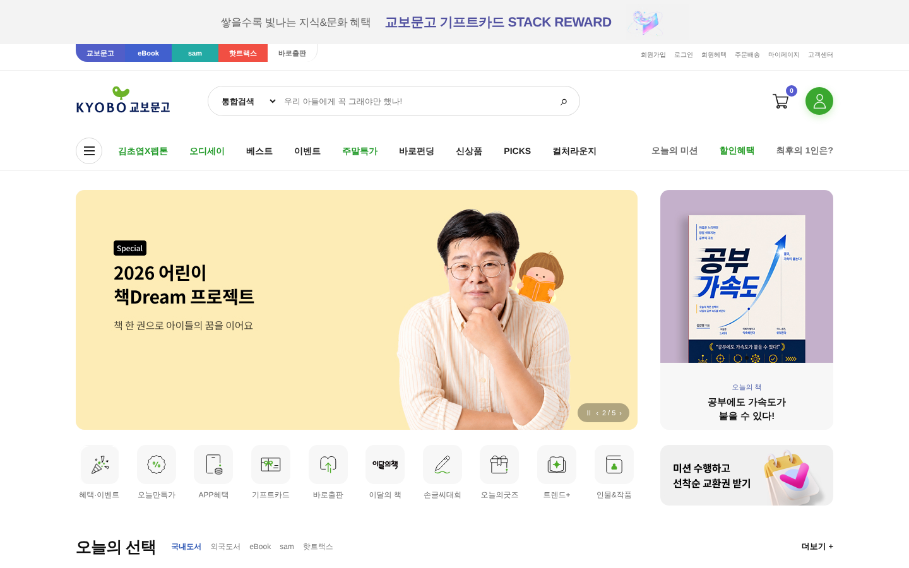
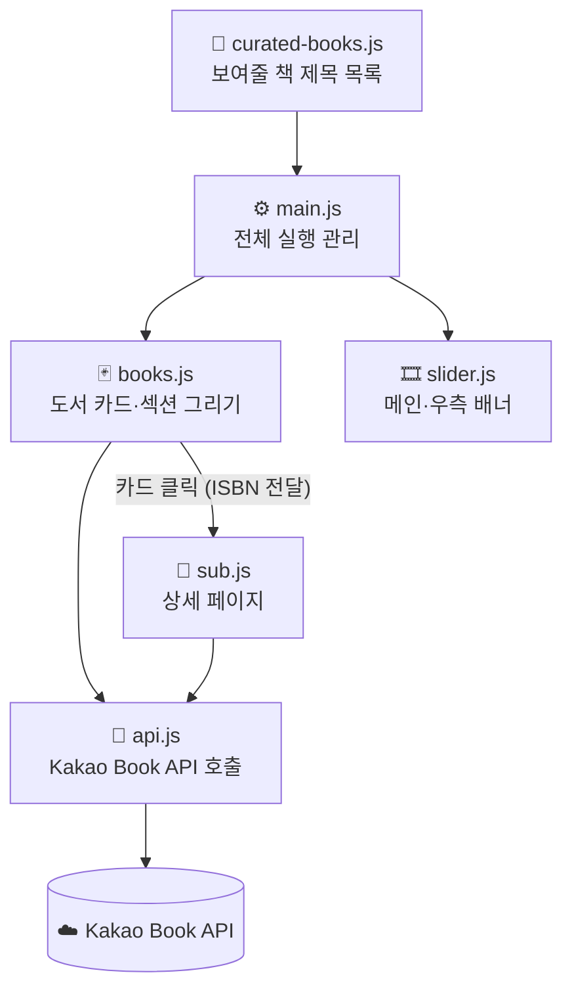
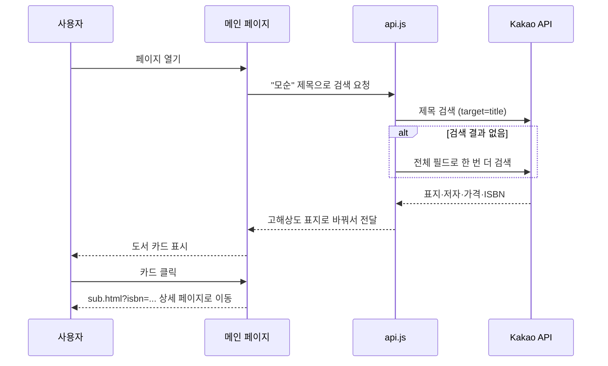
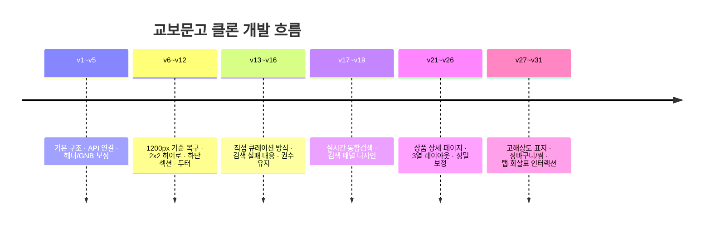

# 📚 교보문고 클론 (Kyobo Book Centre Clone)
> **"실제 서점 화면을 1200px 기준으로 다시 짓고, 책 정보는 API로 채운다"**  
> 교보문고 메인·상품 상세 페이지를 HTML·CSS·JavaScript로 재현하고, **Kakao Book API**로 도서 표지·저자·가격을 실시간으로 불러오는 학습용 클론 프로젝트

<div align="center">


**[🔗 웹에서 보기](https://goalbangg-prog.github.io/Kyobo-Clone/)**

</div>



---

## 📑 목차
1. [프로젝트 개요](#1-프로젝트-개요)
2. [기획 배경 및 목표](#2-기획-배경-및-목표)
3. [주요 기능](#3-주요-기능)
4. [구조와 데이터 흐름](#4-구조와-데이터-흐름)
5. [기술 스택 및 선정 이유](#5-기술-스택-및-선정-이유)
6. [문제 해결 과정](#6-문제-해결-과정)
7. [폴더 구조](#7-폴더-구조)
8. [실행 방법](#8-실행-방법)
9. [개발 과정 (버전 기록)](#9-개발-과정-버전-기록)
10. [발표 자료용 구성](#10-발표-자료용-구성)
11. [저작권 및 크레딧](#11-저작권-및-크레딧)

---

## 1. 프로젝트 개요

| 항목 | 내용 |
|---|---|
| **프로젝트명** | 교보문고 클론 (Kyobo-Clone) |
| **유형** | 개인 프로젝트 · 학습용 클론 코딩 |
| **구현 범위** | 메인 페이지(`index.html`) + 상품 상세 페이지(`sub.html`) |
| **핵심 기술** | HTML5, CSS3(Grid·Flex), Vanilla JS(ES Modules), Kakao Book API |
| **기준 해상도** | 데스크톱 1200px 중앙 레이아웃 |
| **배포** | GitHub Pages |

## 2. 기획 배경 및 목표

### 2.1 문제 정의
- 정적인 클론 코딩은 화면은 비슷해도 **"데이터가 바뀌면 화면도 바뀌는"** 실제 서비스의 구조를 경험하기 어렵습니다.
- 책 정보를 HTML에 직접 적으면, 책 한 권을 바꿀 때마다 여러 곳을 고쳐야 합니다.

### 2.2 해결 방안
- **화면(HTML·CSS)과 데이터(API)를 분리**했습니다. HTML은 틀만 두고, 책 정보는 Kakao Book API로 채웁니다.
- 메인에 보일 책은 `js/curated-books.js` **한 파일에서 제목만 적어 관리**합니다.
- 실제 교보문고 캡처와 나란히 비교하며 크기·간격을 30여 차례 보정했습니다.

## 3. 주요 기능

### 🏠 1. 메인 페이지
- **두 개의 독립 슬라이더**: 중앙 배너(5초 자동 전환·이전/다음·일시정지)와 우측 배너(4초 자동 전환·점 버튼)를 각각 따로 관리
- **2×2 CSS Grid 히어로**: 중앙 배너 / 우측 프로모션 / 퀵메뉴 / 미션 배너
- **오늘의 선택**: 국내도서·외국도서·eBook·sam·핫트랙스 5개 탭마다 다른 도서 세트, 좌우 화살표로 대표 도서와 썸네일 3권이 함께 순환
- **MD 추천**: 분야별 6권 카드, 화살표로 한 권씩 순환
- 트렌드+, 북 퍼포먼스, 출판사 추천, 베스트, Picks, 바로출판POD, 교보문고 Only, CASTing, 이벤트, 푸터까지 실제 화면 흐름대로 구성

### 🔍 2. 실시간 통합검색
- 입력 후 **250ms 뒤** Kakao API 호출 (입력할 때마다 호출하지 않도록 지연)
- 왼쪽 도서 목록(12권, 3권씩 페이지 이동) · 오른쪽 상세 미리보기(마우스를 올리면 변경)
- 관련 인물(저자) · 이벤트 데모 영역
- 결과 클릭 또는 Enter → 해당 책 상세 페이지로 이동

### 📖 3. 상품 상세 페이지 (`sub.html?isbn=…`)
- 주소의 **ISBN으로 책을 찾아** 제목·저자·출판사·가격·표지·소개를 채움
- 좌측 평점 / 중앙 표지 / 우측 구매 정보의 3열 구조
- 함께 구매한 책(저자·출판사 기반 자동 검색), 책 소개·작가정보·목차·리뷰 탭
- 수량 +/- 에 따라 **총 상품금액 실시간 계산**, 하단 고정 구매 바
- 찜·장바구니(브라우저 저장소), 장바구니 개수 표시, 표지 크게 보기, 공유(URL 복사)

## 4. 구조와 데이터 흐름

### 4.1 모듈 구조



### 4.2 책 한 권이 화면에 나오기까지



## 5. 기술 스택 및 선정 이유

| 기술 | 사용한 곳 | 선택 이유 |
|---|---|---|
| **HTML5 / CSS3** | 전체 레이아웃 | Grid로 히어로 2×2, 도서 카드 6열 등 실제 화면 비율을 정확히 맞추기 위해 |
| **Vanilla JS (ES Modules)** | `main.js`, `books.js`, `api.js` … | 프레임워크 없이 DOM·이벤트·비동기 처리를 직접 다뤄 보기 위해, 역할별로 파일 분리 |
| **Kakao Book API** | 모든 도서 정보 | 무료로 국내 도서 표지·저자·가격·ISBN을 받을 수 있는 공개 API |
| **localStorage / sessionStorage** | 찜·장바구니 | 서버 없이 장바구니 동작을 데모로 구현 |

## 6. 문제 해결 과정

### 💡 1. 특정 책이 화면에서 사라지는 문제
- **현상**: "교보문고 Only" 섹션에 5권을 넣었는데 4권만 나옴
- **원인**: '토마토 컬러맨'이 제목 검색에서 결과가 없어 목록에서 빠짐
- **해결**: ① 제목 검색 실패 시 전체 필드로 **자동 재검색** ② 그래도 없으면 직접 넣은 표지 이미지로 **카드를 유지**해 항상 정해진 권수가 보이도록 함

### 💡 2. 책 표지가 흐릿하게 보이는 문제
- **원인**: Kakao API가 주는 기본 썸네일이 120×174px로 작음
- **해결**: 썸네일 주소의 크기 값을 바꿔 **고해상도 표지 주소로 변환**하는 함수(`getHighResThumbnail`)를 만들어 모든 카드에 적용

### 💡 3. 상세 페이지 오류 (`Cannot access ... before initialization`)
- **원인**: 저장소 관련 상수를 선언하기 전에 초기화 함수가 먼저 실행됨
- **해결**: 실행 순서를 바꿔, 모든 선언이 끝난 뒤 `init()`을 실행

### 💡 4. 같은 제목, 다른 책
- **원인**: 같은 제목의 책이 여러 판본으로 존재
- **해결**: 큐레이션 목록에 저자 이름까지 적고("정의란 무엇인가 마이클 샌델"), 상세 페이지에서는 ISBN이 정확히 일치하는 책을 우선 선택

## 7. 폴더 구조

```
Kyobo-Clone/
├── index.html            # 메인 페이지
├── sub.html              # 상품 상세 페이지
├── css/
│   ├── reset.css         # 기본 스타일 초기화
│   ├── common.css        # 헤더·검색·푸터 등 공통
│   ├── main.css          # 메인 페이지
│   └── sub.css           # 상세 페이지
├── js/
│   ├── curated-books.js  # ⭐ 화면에 보여줄 책 목록 (여기만 고치면 됨)
│   ├── main.js           # 메인 실행 · 실시간 검색
│   ├── books.js          # 도서 카드·섹션 렌더링
│   ├── api.js            # Kakao Book API 모듈
│   ├── slider.js         # 메인·우측 배너 슬라이더
│   └── sub.js            # 상세 페이지 기능
├── img/                  # 배너·아이콘·로고·이벤트 이미지
├── docs/images/          # README용 스크린샷
└── README.txt            # 버전별 상세 작업 기록
```

## 8. 실행 방법

1. 저장소를 내려받아 VS Code에서 폴더를 엽니다.
2. [Kakao Developers](https://developers.kakao.com/)에서 앱을 만들고 **REST API 키**를 발급받습니다.
3. `js/api.js`의 `REST_API_KEY` 값을 본인 키로 바꿉니다.
4. **Live Server**로 `index.html`을 실행합니다. (파일을 더블클릭해서 열면 ES Module 때문에 동작하지 않습니다.)

> ⚠️ 브라우저 JavaScript에 넣은 API 키는 개발자 도구에서 보입니다. 학습·포트폴리오 데모용 구조이며, 실제 서비스라면 서버를 거쳐 호출해야 합니다.

**책 바꾸기** — `js/curated-books.js`에서 제목만 바꾸면 표지·저자·가격이 자동으로 바뀝니다.

```js
best: [
  "정의란 무엇인가 마이클 샌델",
  "모순",
  "소년이 온다"
]
```

## 9. 개발 과정 (버전 기록)

v1부터 v31까지 실제 화면과 비교하며 다듬었습니다. 자세한 내용은 [`README.txt`](README.txt)에 있습니다.



## 10. 발표 자료용 구성

| 장표 | 제목 | 담을 내용 |
|---|---|---|
| 1 | 표지 | 프로젝트명, 메인 화면 스크린샷 |
| 2 | 기획 의도 | 화면과 데이터를 분리한 이유 |
| 3 | 구조도 | 4.1 모듈 구조 다이어그램 |
| 4 | 메인 페이지 | 슬라이더 2종, 오늘의 선택 탭·화살표 |
| 5 | 실시간 검색 | 250ms 지연 호출, 검색 패널 구성 |
| 6 | 상세 페이지 | ISBN 기반 렌더링, 수량·가격 계산, 장바구니 |
| 7 | 문제 해결 | 6장의 사례 2~3개 |
| 8 | 마무리 | 배운 점, 다음 과제(서버 프록시, 반응형) |

## 11. 저작권 및 크레딧

- 이 저장소는 **학습·포트폴리오 목적의 클론 코딩**이며 상업적으로 사용하지 않습니다.
- 교보문고 로고, 배너, 이벤트 이미지 등 디자인 자산의 권리는 **(주)교보문고**에 있습니다.
- 도서 정보는 **Kakao Book API**에서 제공받습니다.
- 평점·포인트·리뷰 수 등 교보문고 고유 정보는 화면 구성을 위한 예시 데이터입니다.

---

만든 사람 : 김수현 · [포트폴리오](https://goalbangg-prog.github.io/Portfoilo-V4/)
